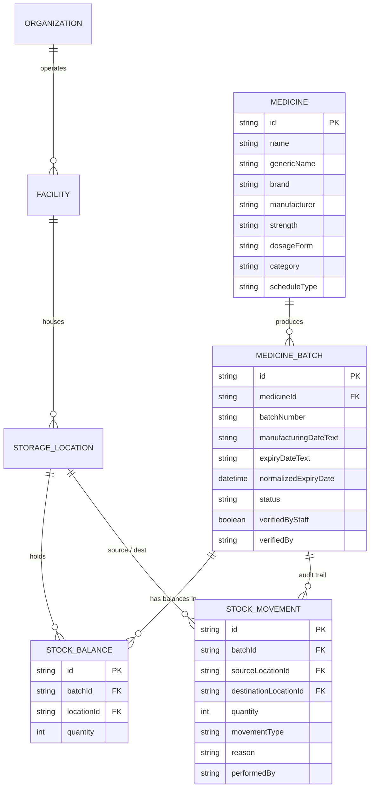

# AyuTrace

> **Every Dose Deserves Care.**  
> *Intelligent Medicine Tracking. Safer Healthcare Workflows.*

AyuTrace is an AI-assisted pharmaceutical inventory management and batch-wise expiry monitoring platform engineered for hospitals, outpatient clinics, retail pharmacies, dispensaries, and medical stockrooms.

---

## 1. Executive Summary & Purpose

Healthcare facilities and pharmacies face persistent inventory challenges:
- **Traceability at the Lot Level:** Point-of-sale and generic ERP systems track overall unit balances without isolating batch numbers or specific printed expiry milestones.
- **Statutory Expiry Compliance:** Under statutory drug regulations (such as the Drugs and Cosmetics Rules), medicines with unverified or past expiration cutoffs must be strictly quarantined from patient dispensing.
- **Month/Year Expiry Labelling Nuance:** Pharmaceutical blister packs and vials commonly print dates as month/year (e.g. `EXP 08/2026`). In accordance with drug standards, such batches remain valid through the **last calendar day of the stated month** (e.g., August 31, 2026).
- **Inter-Ward & Cold-Chain Leakage:** Moving stock between central hospital pharmacies, emergency crash carts, and refrigerated vaults often lacks verifiable audit logging.

**AyuTrace** provides end-to-end stock visibility:
1. **Multimodal Packaging OCR:** Photographically transcribes medicine packaging labels via Google's Gemma 4 vision model.
2. **Mandatory Pharmacist Verification:** Enforces a human-in-the-loop review workflow before any medicine batch is committed to physical ward stock.
3. **Multi-Facility & Location Tracking:** Partitions stock across hospitals, community clinics, and storage shelves with atomic inter-department transfers.
4. **Deterministic FEFO Engine:** First Expired, First Out prioritization with statutory warning horizons (90d, 30d, 7d).

---

## 2. Technology Stack

- **Framework:** Next.js 14 (App Router)
- **Language:** TypeScript 5.6
- **Styling & UI:** Tailwind CSS, Lucide React icons, accessible contrast palette (Teal, Emerald, White, Slate Navy)
- **Visual Analytics:** Recharts (responsive facility stock bars, batch risk donuts, and 12-month expiry exposure curves)
- **Database & ORM:** SQLite with Prisma ORM
- **Validation:** Zod schemas for medicine master data, lot batches, and transfers
- **AI Vision Engine:** Google Gemma 4 (`gemma-4-26b-a4b-it`) via `@google/generative-ai` SDK
- **Audit Preservation:** Previous prototype archived in [`python_prototype/`](file:///Users/siddharthsharma/Documents/Gemma4/python_prototype)

---

## 3. Data Architecture (Prisma & SQLite)

The platform employs a relational schema designed to decouple **medicine master formulation data** from **batch lot facts** and **physical facility balances**:



---

## 4. Application Routes & Key Features

| Route | Role | Key Capabilities |
|---|---|---|
| [`/dashboard`](http://localhost:3000/dashboard) | Operations Center | Real metrics (Registered medicines, stock units, active lots, near expiry, expired, facilities), Recharts visualizations, Critical attention queue, and audit movements |
| [`/scanner`](http://localhost:3000/scanner) | AI Medicine Scanner | Packaging photo upload, Gemma 4 evidence-grounded extraction, Mandatory Pharmacist verification form, and Manual Medicine Intake fallback |
| [`/inventory`](http://localhost:3000/inventory) | Medicine Register | Batch-wise clinical register, search by commercial/generic/lot name, facility filters, dosage form filters, stock adjustments, and details modal |
| [`/facilities`](http://localhost:3000/facilities) | Facilities & Departments | Manage hospitals, clinics, outpatient dispensaries, and cold chain stockrooms with department-level balances |
| [`/transfers`](http://localhost:3000/transfers) | Stock Transfers | Atomic inter-department stock transfers with negative-stock prevention, lot preservation, and verified clinical audit trails |
| [`/expiry`](http://localhost:3000/expiry) | Expiry Monitor | Statutory drug cutoff alerts, 90d/60d/30d horizons, quarantine queue for expired batches, and unverified batch audits |
| [`/analytics`](http://localhost:3000/analytics) | Pharmaceutical Analytics | Stock volume by facility, stock by dosage form (Tablets, Vials, Syrups), and 12-month expiry exposure curve |
| [`/settings`](http://localhost:3000/settings) | System Settings | Organization profile, warning horizon thresholds, date formatting, and server-side Gemma 4 connection status |

---

## 5. Quickstart Guide (macOS)

### 1. Install Dependencies
```bash
cd /Users/siddharthsharma/Documents/Gemma4
npm install
```

### 2. Configure Environment
```bash
cp .env.example .env
```

To enable live Gemma 4 vision scanning, configure your Gemini API key in `.env`:
```text
GEMINI_API_KEY="your-gemini-api-key-here"
GEMMA_MODEL="gemma-4-26b-a4b-it"
DATABASE_URL="file:./dev.db"
```
*(Note: If no API key is configured, manual intake remains fully operational without simulated data.)*

### 3. Initialize SQLite Database & Seed Data
```bash
npx prisma db push
npm run seed
```

### 4. Run Development Server
```bash
npm run dev
```

Open **[http://localhost:3000](http://localhost:3000)** in your browser.

### 5. Automated Verification & Smoke Tests
```bash
npx tsx scripts/smoke_test.ts
```

---

## 6. Clinical Safety & Prototype Disclaimer

> [!IMPORTANT]
> **Administrative Prototype Boundary:**  
> AyuTrace is designed as an administrative medicine inventory, lot traceability, and expiry monitoring tool. It is **not** certified clinical diagnostic, prescribing, or electronic health record (EHR) software. Final dispensing verification remains the statutory responsibility of licensed pharmacists and healthcare practitioners.
